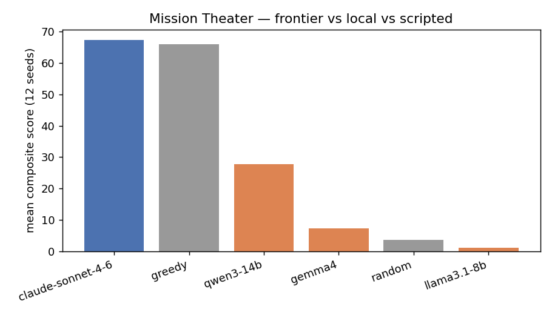

# Mission Theater — measuring long-horizon judgment, not fluency

Most agent benchmarks score single-shot tasks with an LLM grader. That measures
fluency, not the things that actually break long-horizon agents: stale plans,
ignored interruptions, risk misjudgment, and budget blowout. Mission Theater is
a small, deterministic search-and-rescue environment where those failures are
*mechanically* detectable — scored by a pure function of state and trajectory,
never by another model.

**The one-sentence result:** the only agent to out-score a hand-written greedy
floor was a frontier model (`claude-sonnet-4-6`, composite 67.3 vs 66.0) — and
it won on *priority judgment* (converting the mid-mission interrupt into
partial credit) while still losing to the script on the honest bar: solve rate
0.25 vs 0.33, with a hazard death on **8/12** seeds that greedy never pays.
Below it, no local tool-calling model beat greedy at all; the tool-calling
cliff showed up as `llama3.1-8b` under-scanning and looping on **12/12** seeds,
while the best local model (`qwen3-14b`) could secure survivors but ate a
hazard on **8/12** seeds and never fully solved.

---

## 1. The problem I wanted to measure

Fleet coordination under partial observability is a judgment problem. You have a
drone that sees far and a pair of rovers that can secure survivors. Scanning
costs budget; moving blind into fog can destroy a unit. Mid-mission, a rover
drops offline and a high-priority survivor is reported in a far corner. A good
operator re-plans. A brittle one keeps executing the stale plan.

I wanted a harness where:

1. every episode is reproducible bit-for-bit from a seed,
2. success is a number you can audit from the trajectory,
3. the interesting failures have names — not "the model was bad."

That last point is the research taste: a failure *taxonomy* is half the
contribution. "It scored lower" is not a finding. "`ignored_interrupt` on 7/12
seeds while greedy only ignored 2/12" is.

## 2. Three decisions worth defending

**Deterministic env, seeded scenarios.** RNG lives only in scenario
construction (`build_scenario(seed)`). `Theater.step()` contains no randomness.
A "suite" is just a list of integers. Same seed, same walls, same hazards,
forever — so a regression in an agent or a prompt is measurable, not vibes.

**Programmatic reward.** `score()` composes coverage (40%), completion (60%),
an efficiency bonus for finishing under budget, and an 8-point hazard penalty
per unit lost to fog. There is nothing for a model to talk its way past. If the
composite is 27.7, that number is a function of who got secured, who got found,
and who walked into a hazard — full stop.

**Interruptions as the core test.** At roughly budget/3, `rover-2` goes
offline; two steps later a priority-3 survivor appears at the far corner. The
agent gets an `INTERRUPT:` line and no further help. Re-planning vs.
executing-the-stale-plan is the cleanest probe of judgment I could fit in a
grid, and the `ignored_interrupt` tag fires when the action sequence after the
event matches the sequence before it.

## 3. The metric stack

| metric | what it answers |
|--------|-----------------|
| **composite** | headline number (coverage + completion + efficiency − hazard) |
| **solve_rate** | fraction of seeds with every survivor secured — the honest bar |
| **failure histogram** | `early_termination`, `hazard_death`, `under_scanned`, `ignored_interrupt`, `looping` |

The leaderboard is for screenshots. The histogram is for the writeup.

## 4. Results (12 seeds, interruptions on)

Cross-family local tool-callers plus one frontier API model
(`claude-sonnet-4-6` via `AnthropicAgent`) vs. scripted baselines. All local
agents use Ollama with `think=False` (Qwen/Gemma4 are thinking models; leaving
thinking on corrupts multi-turn tool calls and burns wall-clock). Every LLM
agent maintains per-episode tool-call history so each turn is not a fresh
"opening move" — this matters at every scale: run stateless-per-turn, the
frontier model scored 19.2 composite on the 4-seed smoke; with history, 54.0
on the same seeds.

| agent | mean_composite | solve_rate | mean_completion_pct | dominant failure modes |
|-------|---------------:|----------:|--------------------:|------------------------|
| claude-sonnet-4-6 | **67.32** | 0.25 | 64.1 | hazard_death (8), ignored_interrupt (5), solved (3) |
| greedy | 65.97 | **0.333** | 64.4 | incomplete_other (6), solved (4) |
| qwen3-14b | 27.72 | 0.0 | 16.9 | hazard_death (8), ignored_interrupt (7) |
| gemma4 | 7.22 | 0.0 | 4.5 | hazard_death (9), looping (7) |
| random | 3.56 | 0.0 | 0.0 | incomplete_other (11) |
| llama3.1-8b | 1.11 | 0.0 | 0.0 | under_scanned (12), looping (12), ignored_interrupt (12) |

### What the shape says

**The frontier model wins the composite on judgment, not discipline.** Claude
edges greedy (67.3 vs 66.0) despite one fewer solve and an average −8/episode
hazard penalty. The margin comes entirely from partial credit: where greedy's
unsolved episodes plateau at 40–50 (it secures the nearby survivors and never
converts the far corner), Claude's best unsolved episodes reach 74–83
because it re-plans toward the priority-3 interrupt survivor and sometimes
secures it. `ignored_interrupt` fires on 5/12 seeds vs qwen's 7 and llama's
12. Two of its three solves also finished early (27 and 34 turns), collecting
the efficiency bonus greedy rarely sees — without ever being shown the scoring
formula, which the programmatic reward makes unfarmable anyway.

**But the floor still owns the honest bar.** Greedy — scan with the drone,
BFS-route the nearest rover, secure on arrival, ignore interrupts on purpose —
solves a third of the suite and loses zero units to hazards. No model, local
or frontier, cleared 0.333 solve rate. Claude's failure histogram is the
mirror image of greedy's: greedy fails by running out of clock doing safe
things (`incomplete_other` 6/12); Claude fails by dying — a hazard death on
8/12 seeds, the *same rate as qwen3-14b*. Frontier-scale judgment about
priorities did not buy frontier-scale judgment about risk: it still moves
units into unscanned cells that a two-line rule ("never step into fog") would
forbid.

**The tool-calling cliff is a long-horizon collapse, not bad JSON.**
`llama3.1:8b` is a canonical Ollama tools demo model. On this task it
under-scanned, looped, and ignored interrupts on every single seed. The smoke
test (`add(2,3)`) passed. The episode did not. That gap — "can emit a tool call"
vs. "can sequence tool calls under fog for forty turns" — is the whole point of
the harness.

**Size and brand do not substitute for risk judgment.** `qwen3:14b` was the only
local model that partially completed missions (16.9% mean completion, composite
27.7). It also walked into hazards on 8/12 seeds and ignored the interrupt on
7/12. `gemma4` advertises strong tool-calling accuracy and still finished near
random on completion, dying to hazards and loops. Being good at the tools API is
not the same as being a careful operator.

**Interruptions separate the heuristic from the models.** Greedy ignored the
interrupt on only 2/12 seeds (and we know why — it never reads events). The LLMs
*can* see `INTERRUPT:` lines in the observation and still mostly failed to
re-plan toward the far-corner priority target before the budget ran out. That is
the judgment probe firing.

## 5. Honest limitations

- Grid-world abstraction, not a high-fidelity sim. The contribution is the
  *measurement design*, not visual realism.
- The greedy floor is hand-tuned into the 0.3–0.5 solve band; the leaderboard is
  only as honest as that floor. We stopped when greedy hit 0.333 — beatable, not
  solved.
- Single tool-call per turn with a short message window. No long-context memory
  pressure yet; no agent-authored tools inside the sandbox.
- One frontier model, one run, 12 seeds. The claude-vs-greedy composite gap
  (1.35 points) is well within seed-to-seed noise; the solve-rate and
  failure-histogram shapes are the durable findings, not the ranking.
- Local rows and the claude row come from separate trials (same seeds, same
  env code) — archived under `results/trials/20260807_130713/` (local) and
  `results/trials/20260806_110845/` (claude), each with per-turn
  `episodes.json` trajectories.

## 6. What I'd build next

1. **Grow the failure taxonomy** — conflicting reports, ambiguous re-tasking,
   not just "unit offline / new target."
2. **Isolate the risk-judgment gap.** The frontier result answers the ceiling
   question (beats the composite, not the solve rate, eats hazards); the next
   experiment is whether an explicit risk rule in the prompt closes the gap,
   or whether scan-before-move discipline is something scale alone has to buy.
3. **Harden the Dockerfile sandbox** (network-off, read-only FS, seccomp) and let
   the agent author small tools that run inside it.

## 7. Connection to other work

This is a deliberately public, self-contained slice of a problem space I work in
day to day — autonomous coordination of heterogeneous fleets. The proprietary
system is separate; this repo exists to make the *evaluation* methodology
legible: deterministic world, programmatic reward, interruptions as judgment
probes, and a failure histogram you can argue about.

---

*Reproducible from `python run_example.py` after `python verify_models.py`
(local) / `python preflight_claude.py` (frontier). Suite: seeds 0–11,
interruptions on. Trial archives: `results/trials/20260807_130713/` (local),
`results/trials/20260806_110845/` (claude).*
